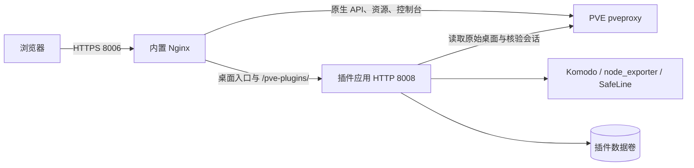

# PVE WebUI Plugins

面向 **Proxmox VE 9** 的非侵入式、可插拔 WebUI 扩展宿主。独立容器内置 FastAPI 与可关闭的 Nginx HTTPS 网关，沿用 PVE 的 ExtJS 组件与登录会话。支持直接访问容器网关，也可接入现有 HAProxy、Nginx 等业务网关。PVE 官方文件、VM/CT 配置和原生管理请求继续由 PVE 提供。

当前版本为 **1.0.0**，采用全新部署的配置契约。模块启停、外部服务连接、别名、图标和附加站点均在「--插件--」中管理，私有配置使用 schema 2。主要变化和兼容边界见 [发行说明](docs/releases/v1.0.0.md)。

## 功能

| 模块 | 功能 | 依赖 |
| --- | --- | --- |
| Komodo | 服务器、应用栈、容器、日志、终端、告警、操作记录与 VM/CT 关联 | Komodo Core、Periphery、服务账号 API 凭据 |
| 节点温度 | 节点概要中的 CPU、主板、磁盘温度及传感器明细 | node_exporter，可选自定义采集器 |
| SafeLine WAF | 防护应用、规则、证书、IP 组、事件、日志与统计 | SafeLine 管理 API |
| 附加站点 | 嵌入页面、站点信息、独立启停、别名、图标与统一排序 | 已保存站点 URL |

首次启动只启用内置附加站点。三个可选模块从管理页启用和配置，停用时不导入实现、不注册业务 API、不提供脚本，也不初始化对应外部客户端或数据库。

1.0.0 是扩展宿主的正式版本，模块各自标识功能覆盖与成熟度：Komodo、SafeLine WAF 为「部分管理 · 测试中」，节点温度为「只读监测 · 测试中」。Komodo 的「统计」「计划任务」仍包含占位页面，部署与代码仓库部分管理功能尚待开放。SafeLine 的可用能力取决于目标版本和授权，附加站点的嵌入效果取决于目标站点与浏览器策略。

## 接入架构



宿主识别 PVE 9 桌面的启动位置，在 `PVE.StdWorkspace` 创建前插入扩展。插件描述文件决定 API、脚本与加载顺序，公开启动片段由模板生成。配置切换使用独立运行实例，关闭旧插件终端并等待已接受的 HTTP 请求完成。

默认网关将桌面入口和 `/pve-plugins/` 交给应用，其余路径转发 PVE，支持上传下载、原生 API 和控制台 WebSocket。单次绕过使用 `/?pve-plugins=off`，原始 PVE 的 `:8006` 入口可用于独立管理与排错。

## 快速部署

GitHub Release 提供经过镜像验证的 `linux/amd64` runtime、debug 镜像归档与 SHA-256 校验文件，以及部署用的 Compose 和环境变量示例。使用预构建 runtime 的下载、校验、`docker load` 和启动步骤见 [v1.0.0 发行说明](docs/releases/v1.0.0.md#使用预构建镜像)。

以下为源码构建方式。

准备能连接 PVE 节点的 Docker 主机，在源码目录创建基础配置。Compose 默认使用命名卷保存配置、数据库和网关证书。

```sh
git clone --branch v1.0.0 https://github.com/sqkkyzx/pve-webui-plugins.git
cd pve-webui-plugins
cp .env.example .env
```

在 `.env` 填写 PVE 节点 IP 和完整管理员 ID。例如 `PVE_UPSTREAM=192.0.2.2,192.0.2.3,192.0.2.4`，这些地址必须属于同一 PVE 集群。每项默认使用 HTTPS 和端口 8006，首项为主节点，其余组成备用池。可显式指定目标端口，例如 `192.0.2.2:443,192.0.2.3:8443`；这些上游端口与容器及宿主机监听端口独立。

默认 `PVE_TLS_VERIFY=false`，到 PVE 的连接使用 HTTPS，但不验证其证书和服务身份。需要验证时，按 [安装说明](docs/wiki/Installation.md) 配置 CA 与逐节点证书名称。

```sh
docker compose config --quiet
docker compose build --build-arg SOURCE_REVISION="$(git rev-parse HEAD)"
docker compose up -d --pull never
curl --fail --insecure https://127.0.0.1:8006/pve-plugins/health
```

浏览器访问 `https://Docker主机地址:8006`。首次启动自动生成并持久化自签网关证书，浏览器会提示证书信任或名称问题。上面的 `--insecure` 用于检查该默认自签入口。也可挂载自己的网关证书和私钥。

已有业务网关可以把全部请求转交 HTTPS 8006。设置 `PVE_INTERNAL_PROXY_ENABLED=false` 后只运行 HTTP 应用 8008，默认发布到宿主机 `127.0.0.1:8008`，可由外部网关按路径分流。两种接法及证书配置见 [安装说明](docs/wiki/Installation.md)。

从增强入口登录 PVE，在左上角打开「--插件--」。[统一管理表格](docs/wiki/Configuration.md) 中可编辑模块和站点、配置连接、设置显示别名与图标，以及调整混合顺序。类型使用颜色和文字区分，「开发进度」说明功能覆盖与成熟度。点击模块后，通过中间的原生竖向菜单切换介绍、基本配置与帮助文档，右侧显示内容，具体范围见 [内置模块](docs/wiki/Modules.md)。

复制 `.env.example` 后默认选择 `pve-webui-plugins:1.0.0`，可使用发行归档载入的镜像；上述本地构建命令也会生成该标签。未设置 `PVE_PLUGINS_IMAGE` 时，Compose 的回退标签为 `pve-webui-plugins:local`。服务使用单个 Uvicorn worker、UID/GID `10001:10001`、只读根文件系统、runtime tmpfs 和独立数据卷。采用单实例管理同一数据目录。

## 基础配置

| 环境变量 | 用途 |
| --- | --- |
| `PVE_UPSTREAM` | 必填，同集群节点 IP 列表，最多 16 项，逗号分隔。支持 IPv4、IPv6 和可选端口，例如 `192.0.2.2:8006,[2001:db8::2]:8006` |
| `PVE_ADMIN_USERS` | 完整用户 ID 白名单，默认 `root@pam`，每名用户还须在 `/` 具有 `Sys.Audit` |
| `PVE_TLS_VERIFY` | 验证上游 PVE 证书，默认 `false`。HTTPS 加密仍启用 |
| `PVE_CA_FILE` | 可选，容器内公开 CA PEM 路径，配合只读挂载 |
| `PVE_TLS_SERVER_NAMES` | 逐节点证书 DNS 名称，顺序与 IP 列表对齐。内置网关启用证书验证时必填 |
| `PVE_PLUGINS_INJECTION_ENABLED` | 桌面注入开关，默认 `true` |
| `PVE_INTERNAL_PROXY_ENABLED` | 内置 HTTPS 网关开关，默认 `true`。关闭后仅运行容器内应用 HTTP 8008 |
| `PVE_PROXY_CERT_FILE`、`PVE_PROXY_KEY_FILE` | 可选网关证书和私钥路径，两者同时设置并只读挂载 |
| `PVE_TRUSTED_PROXIES` | 内置 Nginx 的可信直接对端 IP/CIDR，逗号分隔，用于接受前置代理的 HTTP(S) scheme 标头。仅在内置网关启用时生效 |

直接运行 Python 时可设置 `PVE_PLUGINS_DATA_DIR` 指定统一数据目录。Compose 使用命名卷 `pve_webui_plugins_data` 挂载到 `/app/data`，由映像初始化为 UID/GID `10001:10001` 可写。自定义绑定目录的方法见安装说明。

`PVE_PLUGINS_IMAGE` 选择 Compose 映像。容器与宿主机默认端口一致，`PVE_PROXY_BIND`、`PVE_PROXY_PORT` 将 HTTPS 8006 发布到 `0.0.0.0:8006`，`PVE_PLUGINS_BIND`、`PVE_PLUGINS_PORT` 将 HTTP 应用 8008 发布到 `127.0.0.1:8008`。runtime 目录由映像内部设置到 `/run/pve-webui-plugins`，Compose 为其提供 tmpfs。

保持 IP 列表首项稳定，它也是插件持久化数据的 PVE 标识。主节点不可用时可读取备用节点，备用池不承诺严格逐项顺序。已开始的响应和 WebSocket 会话不会迁移，控制台或终端断开后需要重新连接。写入出现超时或结果未知时先核对 PVE 或外部服务，避免重复提交。

模块连接、凭据和启停以管理页保存的设置为准。宿主私有配置只接受 schema 2 的完整结构。新实例使用独立数据目录初始化，站点库直接创建当前表结构。

### 数据与身份

统一数据目录包含 `plugins.json`、`actions.sqlite3`、`guest-links.sqlite3`、`sites.sqlite3` 和 `safeline.sqlite3`，对应文件按使用模块创建。默认网关证书与私钥保存在 `proxy/`。模块配置、SafeLine 数据库和网关私钥应按私有凭据保护与备份。

业务 API 核验现有 PVE 票据、完整双因素登录、白名单与 `Sys.Audit`。写入另验证同源来源和绑定票据的 `X-PVE-Plugins-CSRF`，并按具体资源处理修订冲突和重复提交。外部操作继续受 Komodo 或 SafeLine 服务账号权限控制。

`GET /pve-plugins/health` 返回宿主状态、版本和启用插件。登录后的管理 API 包括 `/pve-plugins/api/config`、`/pve-plugins/api/navigation` 与各模块独立路径。健康检查与外部连接、实际界面验收分别核验。

## 文档

- [v1.0.0 发行说明](docs/releases/v1.0.0.md)
- [Wiki 首页](docs/wiki/Home.md)
- [架构与设计边界](docs/wiki/Architecture.md)
- [安装与双模式接入](docs/wiki/Installation.md)
- [模块与站点管理](docs/wiki/Configuration.md)
- [内置模块](docs/wiki/Modules.md)
- [升级、备份与排错](docs/wiki/Operations.md)
- [兼容性与发布验证](docs/wiki/Compatibility.md)
- [插件开发契约](docs/PLUGINS.md)
- [Komodo 功能说明](docs/KOMODO.md)
- [节点温度接入](TEMPERATURES.md)

## 开发与验证

使用 Python 3.12 和 Node.js 20 或更新版本。前端为直接载入的 JavaScript。

```sh
python3.12 -m venv .venv
. .venv/bin/activate
python -m pip install --require-hashes -r requirements-dev.txt
python -m pytest -q
node --test tests/*.mjs
```

[CI](.github/workflows/ci.yml) 执行后端和前端回归、语法检查、Compose 配置检查，以及内置站点与三个可选模块的 8 种组合验证。实际镜像还检查 HTTPS 网关、原生路由、WebSocket、主备切换、严格 CA/名称验证和仅应用模式。正式和 debug 镜像分别检查非 root、只读文件系统、资源生成及源码重载行为。

开发时使用对应版本源码，并为 debug 镜像指定独立标签：

```sh
PVE_PLUGINS_IMAGE=pve-webui-plugins:1.0.0-debug docker compose -f compose.yaml -f compose.debug.yaml up -d --build
```

该方式挂载后端、插件和模板源码并监听变更。新 package 的加载器接入与管理界面接入步骤见 [插件开发](docs/wiki/Plugin-Development.md)。

## 竞品与定位

[PVE electrified](https://github.com/bogeeee/pve-manager-electrified) 同样提供 PVE UI 插件能力。本项目重点是独立容器接入、原生 ExtJS 集成、服务端连接配置、插件生命周期和统一模块管理组成的外挂式宿主。

## 来源与授权

PVE 集成从 [sqkkyzx/komodo](https://github.com/sqkkyzx/komodo) 独立整理。源码修订与保留的测试契约见 [NOTICE.md](NOTICE.md)，项目使用 [GNU GPL v3](LICENSE)。PVE 的 ExtJS 与 xterm.js 由用户现有安装提供。
