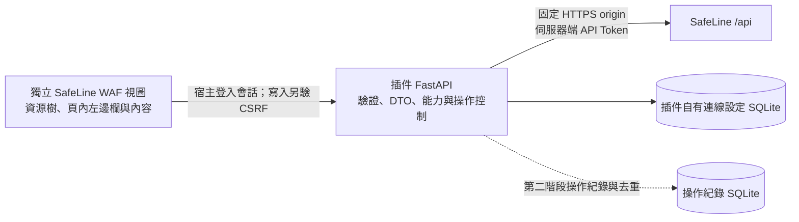

# SafeLine WAF 插件設計草案

狀態：第一階段已實作；後續 WAF 寫入及進階能力仍為設計。調研及實作日期：2026-10-18。

## 依據與驗證範圍

- 已檢視本專案的插件生命週期、PVE 身分驗證、CSRF、現有視圖選擇器與側欄切換，以及多插件組合方式。
- 已透過使用者登入的瀏覽器查看[目標實例 Swagger](https://waf.blsy.team/swagger/index.html)。頁面顯示 `mgt API`、文件版本 `2.0`、Base URL `/api`，並可見 settings、IP 組等接口。管理介面分頁標題顯示「個人版」。文件版本 `2.0` 不代表 SafeLine 產品版本。
- 已由 `10.101.100.101:9443` 匯出目標實例完整 `doc.json`（148 個路徑），路徑集合與 schema definitions 均和官方 Demo 相同。初期具體接口與欄位參考[官方 Demo Swagger JSON](https://demo.waf.chaitin.com:9443/swagger/doc.json)，以[官方 CE CLI 的 API 定義](https://github.com/chaitin/chaitin-cli/blob/main/products/safeline-ce/openapi.json)及[HTTP client](https://github.com/chaitin/chaitin-cli/blob/main/products/safeline-ce/client.go)交叉參考。
- 這是 CE／個人版 API 家族的接入草案，並非目標實例所有接口均已驗證可用。Swagger 中出現 `/commercial/` 或進階功能，也不代表目前授權可以使用。
- 使用 `X-SLCE-API-TOKEN` 已成功讀取系統資訊（產品版本 `9.4.2`）、五類資源、資源詳情、事件／日誌及總覽統計；僅發送 GET，未變更 SafeLine 或 PVE 設定。
- 憑證簽給 `*.blsy.team`，直接使用 IP 會有名稱不符；已核對以 `waf.blsy.team` 作為 SNI／憑證主機名可經該 IP 通過完整 TLS 驗證。

## 接入與導覽

新增獨立插件 `safeline`，在左上角視圖選擇器新增「SafeLine WAF」視圖。選取後，左側顯示 SafeLine 資源樹；右側工作區由「頁內左邊欄」及「頁面內容」組成，依選中資源切換。沿用宿主的 ExtJS 表格、表單、分頁及對話框。

SafeLine 是獨立業務模塊；僅共用插件宿主、介面樣式及登入驗證，不與 PVE 節點、VM/CT 或 Komodo 資源建立業務關聯。

```text
視圖選擇器：SafeLine WAF

左側資源樹
└─ SafeLine WAF（點選開啟總覽）
   ├─ 防護應用                     ← 一級：資源類型
   │  ├─ 應用 1                   ← 二級：具體資源
   │  └─ 應用 2
   ├─ 黑名單
   │  ├─ 封禁條目 1
   │  └─ 封禁條目 2
   ├─ 白名單
   │  ├─ 放行條目 1
   │  └─ 放行條目 2
   ├─ TLS 憑證
   │  ├─ 憑證 1
   │  └─ 憑證 2
   └─ IP 組
      ├─ IP 組 1
      └─ IP 組 2
```

根節點是模塊入口；其下一級按資源類型分組，再下一級列出具體資源。首版提供防護應用、黑名單、白名單、TLS 憑證及 IP 組五種資源類型。總覽、事件、其他防護能力及連線資訊由根節點右側頁內左邊欄提供。

選中根節點時，右側工作區使用以下配置：

```text
右側工作區
┌─ 頁內左邊欄 ─────┬─ 頁面內容 ──────────────────┐
│ 總覽             │ 統計、趨勢、需關注清單       │
│ 攻擊防護         │                             │
│ 防護規則         │ 隨左邊欄選中項目切換         │
│ 連線資訊         │                             │
└──────────────────┴─────────────────────────────┘
```

左側資源樹負責選擇資源，右側頁內左邊欄負責切換該資源的功能；選中不同節點時的行為如下：

| 選中節點 | 右側預設內容 | 頁內左邊欄 |
| --- | --- | --- |
| SafeLine WAF 根節點 | 全域總覽 | 總覽、攻擊防護、防護規則、連線資訊 |
| 防護應用類型節點 | 應用列表，支援搜尋、刷新及進入應用 | 防護應用、高級配置 |
| 具體應用 | 應用基本資訊及防護配置 | 基本資訊、轉發規則、高級配置、應用路由、網頁防篡改 |
| 黑名單／白名單類型節點 | 相應名單列表，支援搜尋、刷新及進入條目 | 名單列表 |
| 具體封禁／放行條目 | 該條目概要 | 概要、匹配條件、作用範圍、命中日誌 |
| TLS 憑證類型節點 | 憑證列表，支援域名、到期狀態篩選及進入憑證 | 憑證列表 |
| 具體憑證 | 該憑證概要 | 概要、憑證資訊、引用應用 |
| IP 組類型節點 | IP 組列表，支援搜尋及進入 IP 組 | IP 組列表 |
| 具體 IP 組 | 該組概要 | 概要、IP 成員、引用關係 |

根節點下的事件及防護規則頁呈現全域資料；具體應用、名單條目、憑證及 IP 組下的頁面只呈現該資源可核對的資料與作用範圍。點選葉節點時同步選中資源並開啟概要；後續切換頁內選單保留資源選中狀態。從列表進入具體資源時採相同流程。其他頁面的名單、憑證及 IP 組引用跳轉至同一資源詳情，並同步選中對應樹節點。

進入 SafeLine 視圖時預設選中根節點並開啟總覽。資源身分由 SafeLine origin、底層資源類型及原始 ID 組成，避免應用與名單條目的 ID 相同時混淆。刷新後名稱變更不改變選中資源；若資源已刪除，顯示資源不存在並提供返回對應列表的入口，不自動切至另一個資源。切換回其他視圖時恢復該視圖的側欄與內容，並停止 SafeLine 頁面的輪詢。

各頁共用實例名稱、連線狀態、最後成功更新時間、刷新及「開啟 SafeLine」入口；後者開啟管理台，不附帶 Token。



## 頁面與 API 對應

下表的上游路徑已包含 Swagger 的 `/api` 基底；插件對外則統一使用 `/pve-plugins/api/safeline/`。所有接口仍需在目標實例驗證。

| 頁面 | 導覽位置 | 內容及互動 | 上游 API 候選 |
| --- | --- | --- | --- |
| 總覽 | 根節點的頁內左邊欄 | 防護應用數、所選時段請求量、各類攔截數、QPS；流量與攔截趨勢；異常應用及即將到期憑證 | `GET /api/open/system`、`GET /api/stat/qps`、`GET /api/stat/advance/access`、`GET /api/stat/advance/attack`、`GET /api/stat/advance/trend/access`、`GET /api/stat/advance/trend/intercept` |
| 防護應用列表／詳情 | 資源樹的類型節點／應用葉節點 | 域名、監聽端口、回源、模式、健康狀態、憑證；搜尋、分組、詳情 | `GET /api/open/site`、`GET /api/open/site/{id}`、`GET /api/open/site/group` |
| 黑名單列表／條目詳情 | 資源樹的黑名單類型節點／條目葉節點 | 封禁條件、作用範圍、優先級、啟用狀態、有效期與命中日誌 | `GET /api/open/policy`、`GET /api/open/policy/detail`、`GET /api/open/records/rule` |
| 白名單列表／條目詳情 | 資源樹的白名單類型節點／條目葉節點 | 放行條件、作用範圍、優先級、啟用狀態、有效期與命中日誌 | `GET /api/open/policy`、`GET /api/open/policy/detail`、`GET /api/open/records/rule` |
| 安全事件 | 根節點的頁內左邊欄；應用內提供限定範圍入口 | 聚合事件清單；由事件進入逐筆攻擊日誌，再查看請求詳情 | `GET /api/open/events`、`GET /api/open/records`、`GET /api/open/record/:id` |
| 防護規則 | 根節點的頁內左邊欄；應用內防護設定展示相應範圍 | 其他自訂規則、應用頻率限制與語意防護；名單及 IP 組引用可進入對應資源 | `GET /api/open/policy`、`GET /api/open/policy/detail`、`GET /api/open/site/{id}/acl`、`GET /api/open/site/{id}/semantics` |
| TLS 憑證列表／詳情 | 資源樹的憑證類型節點／憑證葉節點；應用內展示引用入口 | 名稱或域名、有效期、來源類型、被引用應用；篩選到期憑證 | `GET /api/open/cert`；必要時由後端讀取並裁剪 `GET /api/open/cert/{id}` |
| IP 組列表／詳情 | 資源樹的 IP 組類型節點／具體 IP 組葉節點；規則內展示引用入口 | 說明、內建標記、IP／CIDR 成員、成員數、更新時間及已知引用 | `GET /api/open/ipgroup`、`GET /api/open/ipgroup/detail` |
| 連線資訊 | 根節點的頁內左邊欄 | 已配置狀態、產品版本／版本類型、可用能力、最近錯誤及更新時間 | `GET /api/open/system`、`GET /api/open/system/edition`；不以 Swagger `info.version` 判斷產品版本 |

### 總覽

0.7.0 將「流量分析」與「安全態勢」合併顯示，頂端共用應用／時間選擇器。時間預設為近 24 小時，可依已核對能力提供今天、近 7 天、近 30 天；今天使用瀏覽器當前 UTC 偏移計算本地午夜，統計查詢為秒。日誌查詢起訖仍為毫秒，日誌列時間為秒，聚合事件列時間為毫秒。

實測此目標 9.4.2 CN 個人版：流量分析將其他時段靜默回退到 24 小時，應用篩選亦會被忽略；安全態勢則能區分近 24 小時與近 7 天。後端按 `effective_edition` 優先於 `version` 決定已核對能力，不拿付費但已失效的授權當作可用。未知版本類型或無法取得能力時，保守提供全站近 24 小時。界面只開放任一區塊支援的時段，選到僅安全態勢支援的 7 天時，流量卡片明確顯示不可用，不用 24 小時數值冒充。

| 目標 CN 能力類型 | 流量應用篩選 | 流量時段 | 安全態勢應用篩選 | 安全態勢時段 |
| --- | --- | --- | --- | --- |
| 個人版 0 | 不支援 | 近 24 小時 | 不支援 | 近 24 小時／7 天 |
| 專業版 1 | 支援 | 今天／近 24 小時／7 天／30 天 | 不支援 | 今天／近 24 小時／7 天／30 天 |
| 商業版 2 | 支援 | 今天／近 24 小時／7 天／30 天 | 支援 | 今天／近 24 小時／7 天／30 天 |

矩陣依目標管理台的 capability catalog 與時間解析器核對；當前個人版另有真實查詢比對，其他版本使用狀態式模擬 API 驗證查詢參數與範圍，不宣稱已在付費實例驗收。全部應用時省略 `site_id`，不能傳管理台內部選項的 `-1`，因目標接口會回傳 400。

0.7.1 按工作區內容寬度排列：寬視窗的流量分析左側顯示兩列統計及等寬的「即時 QPS／訪問情況／攔截情況」，右側整欄顯示地理位置；安全態勢左側顯示全部七項指標及攻擊趨勢／來源 IP，右側整欄顯示實時事件。兩區共用約 3:1 的欄寬，窄視窗自動換行。總覽標題旁的刷新按鈕重新查詢當前範圍並保留應用、時段及地理位置選項。時間條件在總覽內共用，切換後重新查詢，不由某頁日誌推算全站統計。

- 先顯示已取得的面板，單一統計接口失敗不清空整頁。
- API 缺少資料時顯示「不可用」與更新時間；統計關閉時標示「未啟用統計」，不能補成零。
- 流量指標包括請求、PV、UV、IP、攻擊 IP 與管理台同口徑的六類 `intercept` 計數之和。4xx 上游與 WAF 分開展示；5xx 使用兩者之和。錯誤／攔截率以同範圍請求次數為分母，缺少任一必要值或分母為零時不生成比率。
- `GET /api/stat/advance/error_status_code` 以 `upstream=true/false` 分別取得上游與 WAF 錯誤數。QPS 來源是五秒請求桶，沿用目標管理台的 `ceil(sum(bucket)/5)`；顯示最近 35 桶，每 30 秒刷新。QPS 不隨歷史時段回溯。
- 地理位置使用 `GET /api/stat/advance/location`，`global=true/false` 對應世界／中國，`action=-1/1` 對應訪問／僅攔截，`size=-1` 取得完整地區集合並限制回應大小。四份結果共用同一查詢範圍，一次載入後按鈕本地切換；長條按最高值比較，不把已定位資料的合計當作所有請求總數，不生成空白地區或地球圖。
- 安全態勢使用 `/api/open/security_posture/statistics` 與 `/trends?type=attack&top=10`；分別顯示攻擊、黑白名單、限頻、等候室、人機驗證、身份認證及防篡改計數，趨勢區分已攔截與已放行。攻擊來源 IP 使用原始 top 計數。
- `/api/open/security_posture/realtime?top=7` 顯示最近事件，明確標示獨立於時間篩選。保留事件類型、應用、時間和安全裁剪後的定位欄位，不能透傳未知欄位或整筆 HTTP 內容。
- 每個區塊獨立處理失敗；切換應用／時段先清除舊內容並中止舊查詢，回應必須匹配請求的範圍與世代。輪詢不重疊統計請求、不重建選擇器；所有 CSS 只作用於本插件總覽容器。

### 防護應用

資源樹的「防護應用」類型節點開啟應用列表；葉節點對應 SafeLine 的具體 site 資源，介面統一稱「應用」，上游 API 名稱保留 `site`。

0.8.0 在類型節點的頁內側欄加入「高級配置」，編輯全域應用預設，不改寫各應用的自訂值或繼承旗標。`GET/PUT /api/open/global/proxy` 支援源 IP 方式、動態 XFF 的方向與位置（1–100）、自訂來源 Header、PROXY protocol 信任代理、IPv6、HTTP/1.0／HTTP/2、HTTPS 跳轉、HSTS、Host、X-Forwarded-Host／Proto、重寫 XFF、Gzip／Brotli、SSE、NTLM 及預設憑證行為。

0.8.1 將高級配置改為 PVE 原生「項目／值」表格，選中一行按「編輯」或雙擊開啟該項設定視窗；源 IP、HSTS 等相關欄位各合併在同一行。每次開啟視窗先讀取最新值及指紋，儲存確認後關閉視窗並更新表格，保留選中的設定行。

固定值使用原生選擇器或勾選框，Host 與密碼套件保留自訂輸入。SSL 協定為多選，HTTP Header 以結構化表格編輯請求／回應目標與設定／刪除動作。SSL 自訂、Header 操作及應用分組遵循目標管理台的專業版／商業版能力；個人版仍可編輯基礎項目。分組以 `GET /api/open/site/group/switch` 讀取，另行透過 `PUT /api/commercial/site/group/switch` 儲存。

只送出所選設定行中使用者變更的欄位，沿用連線版本、設定指紋、CSRF、操作編號去重及儲存後回讀。Header 中的敏感值不回填，使用不透明索引保留原值，也可輸入新值替換或移除該操作；後端拒絕將原有敏感值轉移至不同名稱或目標。編輯視窗開啟時暫停輪詢，刷新資源樹也會保留草稿；未確認的寫入保留草稿並停用重送，需重新讀取後核對。

0.8.2 的應用主表顯示名稱、說明、狀態、域名、監聽、今日請求、今日攔截，以及 CC／BOT／身份認證／攻擊防護四項開關，與 SafeLine 應用卡片的資料一致。請求與攔截直接讀取列表的 `req_value`／`denied_value`，不增加逐應用請求或用其他統計時段代替。CC 依 `cc_bot`；BOT 依 `challenge_is_enabled || chaos_is_enabled`，已停用但仍保留的策略 ID 不視為啟用；身份認證依正數 `auth_defense_id`；攻擊防護依 `semantics`。開關顯示勾選／空白，未知或過期顯示「—」；數值 0 保留為 0，缺失或無效計數不補 0。

資源樹葉節點優先顯示應用名稱，缺少名稱時使用域名作為標籤，以 ID 保持唯一。從主表或樹葉節點開啟同一應用詳情，右側頁內左邊欄提供「概要／代理設定／防護設定／安全事件與日誌／TLS 憑證」。

- 區分站點啟用狀態與運作模式；官方參考定義的 `mode` 為 `0` 防護、`1` 離線、`2` 觀察，實際映射仍以目標實例為準。離線與觀察有不同影響，介面分別命名。
- 健康狀態使用既有 `health_state`；未取得時顯示未知，不因顯示頁面便自動觸發回源健康檢查。
- 編輯頁只負責已支援欄位。若上游使用整體 PUT，必須保留未編輯設定並確認讀寫欄位映射；未知版本或無法保留的欄位使該操作保持不可用。
- 回源資訊按 SafeLine 資料展示，不關聯 PVE 節點或 VM/CT。

### 攻擊防護、事件與日誌

「事件」與「逐筆日誌」使用不同資料模型、分頁及總數。目標實例事件 `id` 為數字，日誌 `event_id` 為另一個字串 ID；實測直接傳事件數字 ID 未取得相應日誌。因此事件詳情按 IP、Host、端口及起訖時間查詢相同條件日誌，明確標示查詢範圍，不宣稱已驗證唯一事件關聯。

- 事件篩選使用上游已支援的時間、來源 IP、Host、端口；逐筆日誌再提供處置動作、攻擊類型、URL、事件 ID 等條件。
- 一般攻擊與自訂規則命中的事件／日誌使用各自的 `/events/rule`、`/records/rule` 等接口，介面清楚區分來源。
- 全域與應用內的日誌頁使用明確的資源範圍。只有上游接口與已核對欄位能精確限定某應用時才顯示應用專屬結果；不以模糊 Host 搜尋或全域日誌冒充單一應用日誌。
- 日誌詳情用文字元件顯示 HTTP 內容與命中資訊，轉義外部字串，對 Cookie、Authorization 等敏感欄位做遮罩。
- 分頁依表格可用高度計算完整行數，最高 100 筆；亦可手動選擇 20／50／100 筆。時間戳單位由各接口適配器處理，不能把日誌與統計查詢直接共用參數。攔截／放行使用淺紅／淺黃底色。

### 人機驗證

0.11.0 在根節點的頁內左邊欄加入「人機驗證」，位於防護規則與連線資訊之間。沿用原生單行表格，分列來源 IP、屬地、應用、域名、觸發次數、通過次數、持續時間與開始時間；雙擊來源 IP 使用既有的加入 IP 組視窗。行數依實際表格高度自動計算，亦可手動選擇 20／50／100 筆；切換頁面、登出及開啟編輯視窗時遵循現有請求取消與輪詢規則。

列表使用 `GET /api/open/records/challenge`，來源為獨立的人機驗證記錄，不由攻擊日誌或 HTTP 狀態碼推算。`ip` 篩選來源 IP，`site` 模糊搜尋應用名稱／備註；不將域名當作此接口已支援的搜尋欄位。起訖以毫秒傳至 `started_at_begin`／`started_at_end`，篩選的是記錄的開始時間。持續時間使用 `dur_sec`，`ended_at=0` 額外標示「進行中」。觸發與通過各自保留 0，缺失或無效值顯示未知；不傳送圖示、報文或未知上游欄位。

「配置」透過 `GET /api/open/challenge/config` 顯示全域驗證服務，提供雲端／本地兩個選項；切換使用 `POST` 同一路徑。依目標管理台的授權判斷，專業版／商業版才可切換服務；個人版可查看現有值。沿用連線版本、設定指紋、CSRF、操作編號去重與寫入後回讀，結果未確認時保留草稿並停用重送。此配置不替代個別應用中的 BOT 防護、驗證條件或 CC 規則。

本次在目標 9.4.2 CN 個人版驗證了列表共 20 筆、IP／應用備註／毫秒時間篩選及配置讀取；真實驗收僅讀取資料。服務切換與失敗、衝突、重送行為由狀態式 API 測試驗證，不在實際 WAF 上變更驗證服務。

### 黑名單與白名單

0.12.0 把資源樹的黑、白名單合併為「黑白名單」，葉節點以「攔截：」「放行：」加名稱標示，仍以原始 policy ID 辨識。頁內側欄提供黑名單、白名單、檢測事件、檢測日誌；所有列表保持原生單行表格，啟用狀態使用勾選／空白。

依目標實例契約，`action=1` 為封禁、`action=0` 為放行；混合在線規則庫 `action=999` 按 `black_rule`／`white_rule` 出現在相應列表，兩個樹入口指向相同底層資源。其他未知動作保留在防護規則頁，不強行分類。

兩種名單都提供「添加規則」「訂閱在線規則」及編輯。新增使用 `POST /api/open/policy`，編輯使用 `PUT` 同一路徑；可選首位／末位插入。匹配條件按原管理台提供 AND／OR 組、目標與合法運算子，來源 IP 支援 IP／CIDR、IP 組、地理位置；其餘包括應用、URL／路徑、Host、參數、Header／Body、HTTP 方法及 JA4。IP 組、應用、方法、指紋庫和地理位置使用可選值；Header／參數有獨立名稱。地理位置及回應條件遵循有效授權。JA4 接口回傳單個指紋庫物件，選項保留其 ID。國家／省分代碼採目標管理台的 ISO 目錄（9.4.2 CN）。敏感、未知或不能無損編輯的條件保留在後端，仍可改其他欄位。

排序只包含同一動作的全部自訂規則，內建／在線規則庫不可移動。上移、下移、指定位置先改草稿，按「套用排序」才以 `PUT /api/open/policy/orders` 寫入完整 ID 與連續位置。取得規則不完整、ID 集合變更或設定已被其他人修改時拒絕提交；即時命中計數不影響設定指紋。

0.13.1 的規則側欄為「概要／匹配條件／命中日誌」，移除作用範圍頁。概要頂欄提供「啟用」「禁用」「刪除」，基本資訊可編輯名稱、黑／白名單類型及順序序號，另保留友好的文字條件預覽。「匹配條件」頁將條件組以獨立兩欄表格往下排列，展示「並且」「或者」、易讀目標及運算子，將應用、IP 組與 JA4 庫 ID 對應為名稱；值保持原樣，含敏感內容者仍遮罩，未知條件只讀。頁面明示「匹配任意條件組即命中規則；每個條件組內需要同時匹配所有條件」，原有取反旗標另作說明。

分組預設只讀，雙擊單條件後用具體目標／方式／內容表單編輯。各組提供添加 AND、刪除選中條件、刪除本條件組；頂欄提供添加 OR 條件組，保留至少一組、一條條件。全部變更先留在本地草稿，按「儲存」才提交差異；切換概要與匹配條件、背景或手動刷新資源樹均不覆蓋草稿，取消變更會重新讀取目前頁面，儲存成功後保留所選頁面。名稱／類型變更仍使用已核對的 `PUT /api/open/policy` 欄位；序號透過目標動作的完整自訂規則排列寫入 `/policy/orders`，改類型時使用所選位置。兩步寫入有任一步結果不確定即回報未知，停止重送，供使用者重新載入核對。

啟停使用窄化 `PUT /api/open/policy/switch`（ID、布林狀態），回讀同一 ID 核對；刪除使用 `DELETE /api/open/policy`（ID），先在確認視窗輸入完整名稱，再以完整規則清單確認該 ID 已移除。內建條目不可刪除，在線規則庫明示整庫移除；各操作沿用 PVE 鑑權、CSRF、設定指紋、連線版本與操作去重。實際 WAF 驗收只執行讀取與本地草稿交互，寫入由狀態式 API 測試驗證。

在線目錄使用 `GET /api/open/cloud/policies`；選取後明確展示黑、白名單數，`POST /api/open/cloud/policies/subscribe` 訂閱整個規則庫。已添加項不可再次訂閱。保存均沿用版本、指紋、CSRF、操作編號去重及回讀確認。

檢測事件／日誌固定讀取 `/events/rule`、`/records/rule`。事件可依 IP、Host、端口、起訖時間篩選，放行／攔截命中數雙擊後進入檢測日誌並帶入精確條件；來源 IP 使用加入 IP 組視窗，畫像欄跳轉外部畫像。日誌另有規則 ID、動作、黑／白名單類型、路徑、ID、JA4 等篩選，直接展示列表已有的 `policy_name`、`policy_rule_id`；其他欄雙擊讀取檢測詳情及報文，不逐筆加請求。

「命中日誌」使用 `/api/open/records/rule` 的 `policy_rule_id` 精確查詢所選條目。條目動作由封禁改為放行或相反時，樹節點依核對後的狀態移至對應類型，保留同一底層 policy 身分；名稱變更也維持原選中資源。

條目可能包含多個匹配條件，不能假定每個資源只是單一 IP。共用 IP 組作為條件引用，建立 IP 組本身不等於建立封禁或放行條目。

### CC 防護

0.12.0 在根節點側欄加入 CC 防護及「頻率限制／等候室」。頻率限制使用 `GET /api/open/records/acl`，展示來源 IP／屬地、應用、原因、處理方式、攔截數、觸發時間、狀態；篩選使用 IP、應用備註 `site`、開始／結束時間。原台以毫秒向上取整為秒後傳至 `begin`／`end`，插件按相同整數規則處理。等候室使用 `/records/waiting`，展示活躍門檻、總／峰值人數、平均等候秒數、跳出率、持續時間及開始時間；其開始時間為秒，與人機驗證的毫秒不同，篩選開始向下／結束向上取整為秒，跳出率由 0–1 換算百分比。

全域配置讀取 `/site/0/acl`，以子視窗編輯門檻、統計時段、限制時長、動作及狀態碼。先改草稿，保存時把欄位差異合併到完整原始規則，保留條件、未知欄位及繼承，`PUT` 後按 ID 和修改欄位核對。解封先讀完目前篩選範圍，展示仍生效的 ID；確認時向 `PUT /api/acl/relieve` 傳入明確 ID 列表，絕不發送代表不限範圍的空 ID 陣列。

目標 9.4.2 CN 個人版實際讀取核對：頻率限制 5 筆、等候室 6 筆、檢測事件 167 筆、檢測日誌 1311 筆、在線目錄 100 個規則庫。真實驗收只執行 GET；新增、編輯、排序、訂閱、全域配置及解封的寫入／回讀、衝突、失敗和重放由狀態式測試驗證。

### 防護規則

首階段呈現規則與實際作用範圍。後續編輯以「條件 → 動作 → 作用範圍 → 順序／到期時間」組成表單。

根節點的防護規則頁承載其他自訂規則與共用防護能力。黑白名單及 IP 組透過資源樹管理；頁面需要展示或編輯這些資源時，進入對應資源詳情。

### TLS 憑證

TLS 憑證為一級資源類型，每張憑證是二級資源。選中類型節點時開啟全域憑證列表，選中具體憑證時，右側頁內左邊欄提供「概要／憑證資訊／引用應用」。樹節點優先顯示可用名稱或域名，使用原始憑證 ID 辨識。

首階段提供憑證資訊及應用引用關係。總覽中的即將到期清單、應用詳情中的憑證入口均跳轉至同一憑證資源；「引用應用」可跳轉至對應應用資源。

列表資料優先；只有取得必要資訊時才讀詳情。參考定義的 `cert.CertDetail.manual.key` 可能含私鑰，因此後端用欄位白名單建立展示 DTO，不透傳完整詳情，也不把私鑰寫入快取或操作紀錄。

### IP 組

IP 組為一級資源類型，每個具名 IP 組是二級資源；成員 IP／CIDR 位於該組右側詳情的成員表中，維持「資源類型 → 具體資源」的樹層級。類型節點開啟列表；具體 IP 組的頁內左邊欄提供「概要／IP 成員／引用關係」。

列表及概要展示說明、內建標記、成員數與更新時間。葉節點使用可用說明作為名稱，沒有說明時顯示「IP 組 #ID」，並始終以原始 ID 辨識；展示及編輯能力依實際接口核對。

IP 組可以被黑白名單或其他規則引用。引用頁只展示從已驗證欄位能確認的關係，未取得完整資料時標示引用資訊不完整；不把原始 `reference` 字串或文字匹配直接當成完整引用圖。名單／規則中的 IP 組入口與樹中的該資源共用詳情。

## 二級資源圖標與狀態

2026-10-18 核對的 PVE 原生圖標形態、class、字形、色碼與來源已獨立保存於 [PVE 原生資源圖標參考](PVE-NATIVE-ICONS.md)，供所有插件共用。常規設計與實作先查該文件，遇到版本／主題差異或新形態時再核對上游。

### 原生形態

沿用參考文件中的原生形態。這些角標與資源類型圖標分開組合；SafeLine 二級資源保留自己的基礎圖標，再選取一種適合的狀態形態。首版建議：應用 `fa-globe`、黑名單 `fa-ban`、白名單 `fa-check-circle-o`、憑證 `fa-certificate`、IP 組 `fa-list-alt`。一級類型目錄維持中性資料夾／類型圖標。

### SafeLine 狀態映射

| 資源 | 已核對資料可確認的狀態 | 顯示形態 | 狀態文字 |
| --- | --- | --- | --- |
| 防護應用 | 已啟用且為防護模式 | 綠色三角 `running` | 防護模式 |
| 防護應用 | 觀察模式 | 黃色雙豎線 `paused` | 觀察模式 |
| 防護應用 | 手動離線或停用 | 淡灰 `stopped` | 已離線／已停用 |
| 防護應用 | 已確認部分回源異常 | 黃色警告 `pending` | 部分回源異常 |
| 防護應用 | 已確認回源全部不可用或明確資源故障 | 紅色叉號 `error` | 回源不可用／異常 |
| 黑名單／白名單條目 | 已啟用且未到期 | 綠色三角 `running` | 已啟用 |
| 黑名單／白名單條目 | 已停用 | 黃色雙豎線 `paused` | 已停用 |
| 黑名單／白名單條目 | 已到期 | 淡灰 `stopped` | 已到期 |
| TLS 憑證 | 已確認有效且不在到期提醒期內 | 綠色勾 `online` | 有效 |
| TLS 憑證 | 即將到期 | 黃色警告 `pending` | 即將到期 |
| TLS 憑證 | 已過期或已撤銷 | 紅色叉號 `error` | 已過期／已撤銷 |
| IP 組 | 已取得可用的組資料 | 中性基礎圖標，無運行角標 | 已載入；另標示成員數／引用資訊 |
| 任意資源 | 判斷所需欄位缺失、狀態尚未取得或已無法確認 | 灰色問號 `unknown` | 狀態未知／資料已過期 |

映射規則：

- 應用的綠色三角只表示已核對的防護配置，不保證所有回源健康。`health_state.state` 的數值在目前參考定義中未給出 enum，須核對目標實例後才用於警告／故障判斷；未啟用健康檢查或資料缺失不當成回源失敗。
- 名單的綠色三角表示規則已啟用；規則是否命中與是否在所選應用生效仍由條件、範圍及優先級決定。有效期的單位與永久有效值必須先核對；到期優先於「已啟用」顯示。
- 憑證依 `expired`、`revoked` 及可解析有效期判斷，提醒期初始建議為 30 天。使用中、未引用、自簽與來源類型作為額外資訊，不直接等同有效、停用或錯誤；失效優先於即將到期。
- IP 組目前參考欄位沒有 `is_enabled` 或執行狀態，不建立虛構啟停狀態。空組、未引用與內建標記用狀態文字或詳情表達，保留中性圖標。
- API 查詢失敗表示無法更新資源狀態，不能直接把資源標成停用或故障。需要最新資料才能確認的狀態轉為問號，並顯示最後成功更新時間；已核對的到期時間等仍可判定的事實可保留。
- 備份、遷移、掛起及 HA 維護角標沒有直接對應的 SafeLine 業務含義，首版不套用。第二階段只有已接受的寫入確實執行中時，才可暫用小鎖，並以文字標明操作；一般刷新不覆蓋資源狀態。

### 呈現與更新

後端 DTO 分開保存原始資源狀態、健康資訊、資料新鮮度及操作狀態，再派生顯示狀態及原因；不把 `running` 等圖標樣式名稱當成 SafeLine 原始狀態。

前端只在本插件的樹節點及資源表格上組合基礎圖標與原生 class；不修改 PVE 官方檔案或全域資源類型定義。不為外部資源捏造 PVE VM/CT 類型以取得圖標。

原生多個角標共用 `:after`，不能直接堆上所有狀態 class 來表達多個含義。每個節點選定一種主要角標，其餘狀態寫入 tooltip／詳情；刷新時完整替換原狀態 class，避免殘留綠色三角或錯誤標記。

樹節點 tooltip、資源列表與右側概要使用同一份狀態文字及原因，不能只靠顏色辨識。更新圖標時保留資源 ID、選取及展開狀態，不重建整棵樹；讀取失敗、欄位缺失、啟停、到期邊界與亮／暗主題均列入實作驗收。

## 後端結構與設定

```text
plugins/safeline/
├─ __init__.py
├─ plugin.json
├─ plugin.py                 setup、連線池與 shutdown
├─ connection.py             延遲開啟的設定儲存、憑據及修訂控制
├─ client.py                 固定 origin、Token、TLS、錯誤與超時
├─ service.py                五類資源 DTO、統計、日誌及部分錯誤
├─ dashboard.py              合併總覽、四種地理排行及統計能力邊界
├─ routes.py                 PVE 驗證後的業務路由
├─ editing.py                受限欄位編輯、內容指紋、寫入及結果核對
└─ static/safeline.js         ExtJS 導覽及頁面
```

`plugin.json` 使用 `id: safeline`、`requires: []`，資源位於 `/pve-plugins/assets/safeline/safeline.js`。前端註冊獨立視圖 key `pve-safeline-waf`，透過既有視圖選擇器及側欄切換契約接入。

可使用 `after: ["komodo", "sites"]` 安排共用視圖 hook 的可選載入順序；這不會啟用或依賴這兩個插件。切換時，各插件只管理自己擁有的資源樹、頁內左邊欄、頁面與請求，保留原始 hook；需驗證與容器視圖、附加站點視圖來回切換時，不殘留側欄、不重複觸發選取，也不串用資料。

建議明確啟用：`PVE_PLUGINS=komodo,temperatures,sites,safeline`。保留既有預設組合，避免既有安裝升級後自動新增外部接入。

### 在頁面設定連線

根節點右側「連線資訊 → 編輯連線」提供管理地址、API Token、TLS 憑證驗證、可選憑證主機名及 CA PEM。測試草稿不保存，保存後立即生效，不必改環境變數或重新啟動容器。

前端透過同源插件 API 提交，後端保存並呼叫 SafeLine。目標 API 的跨域 OPTIONS 預檢實測回應 404，沒有 CORS 允許標頭；自訂 Token header 的瀏覽器跨域呼叫需要預檢，見 [MDN CORS](https://developer.mozilla.org/en-US/docs/Web/HTTP/Guides/CORS)。

- 設定保存在資料卷的 SQLite；檔案 `0600`、新建目錄 `0700`，採檔案權限保護，未宣稱資料庫本身已加密。前端只取得 Token 已設定標記，不回填原文，不使用 localStorage／sessionStorage；參考 [OWASP 瀏覽器儲存指引](https://cheatsheetseries.owasp.org/cheatsheets/HTML5_Security_Cheat_Sheet.html#local-storage)。
- 讀取與編輯均沿用 PVE 管理者白名單與會話；測試、保存及清除另驗證來源、CSRF 與設定修訂。
- 留空僅沿用同一地址及同一憑證主機名的已存 Token；變更目標需要重新填寫。
- 保存後清除舊資源、選取及未完成請求。設定衝突不自動覆蓋；頁面保存優先於部署初始值，清除記錄不會重新啟用環境憑據。
- 可分開填寫連線 IP 與憑證主機名，使用 [HTTPX SNI extension](https://www.python-httpx.org/advanced/extensions/#sni_hostname)保持 TLS 驗證；不修改 DNS 或主機 hosts。

| 可選部署設定 | 用途 |
| --- | --- |
| `SAFELINE_URL`、`SAFELINE_API_TOKEN` | 尚未保存記錄時的初始連線；非必填 |
| `SAFELINE_CA_FILE`、`SAFELINE_TLS_SERVER_NAME` | 初始 CA 檔案及憑證主機名；均可在頁面填寫 |
| `SAFELINE_STATE_FILE` | 設定 SQLite；Compose 為 `/app/data/safeline/connection.sqlite3` |

### 已實作路由

| 路由 | 用途 |
| --- | --- |
| `GET /pve-plugins/api/safeline/connection` | 裁剪後設定、修訂及 CSRF，不回傳 Token |
| `POST /pve-plugins/api/safeline/connection/test` | 測試草稿，不保存或變更 WAF |
| `PUT /pve-plugins/api/safeline/connection` | 保存插件連線 |
| `DELETE /pve-plugins/api/safeline/connection` | 清除插件連線，保留停用標記 |
| `GET /pve-plugins/api/safeline/status` | 連線、版本及錯誤 |
| `GET /pve-plugins/api/safeline/inventory` | 五類資源、其他規則、各類錯誤與未完整載入標記 |
| `GET /pve-plugins/api/safeline/resources/{kind}/{id}` | 所選資源詳情，應用可選代理或防護設定 |
| `GET /pve-plugins/api/safeline/resources/{kind}/{id}/edit` | 最新可編輯欄位、鎖定欄位及綁定目標的內容指紋 |
| `PUT /pve-plugins/api/safeline/resources/{kind}/{id}/edit` | 具體資源編輯；`section` 為 settings、mode、switch 或 proxy |
| `GET /pve-plugins/api/safeline/overview` | 統計、趨勢及獨立面板錯誤 |
| `GET /pve-plugins/api/safeline/events`、`GET /pve-plugins/api/safeline/records` | 分頁事件／日誌，區分一般或自訂規則來源 |

沒有透明 API 轉發。修改只走固定方法、路徑與欄位白名單。憑證查閱使用列表 metadata；編輯時可在後端讀取詳情，但不把舊 PEM 或私鑰回填表單。日誌詳情呈現安全 DTO，遮罩認證／Cookie 標頭，本文不傳至前端；不猜測記錄 ID 以呼叫未知詳情路由。

### 會話、資料與生命週期

- 每個業務路由呼叫既有 PVE authenticator，沿用完整登入、管理者白名單及 `/` 的 `Sys.Audit`。未配置 SafeLine 時顯示待配置狀態。
- `setup` 只建立延遲儲存物件及路由；授權請求才開啟設定 SQLite、讀取憑據及建立 HTTP client。不複製整套 WAF 設定或長期保存攻擊日誌。
- 插件停用時不匯入實作、不讀憑據、不建立 client／資料庫、不註冊 API、不提供或載入腳本。
- HTTP client 驗證 TLS、拒絕跨 origin 重新導向、限制回應大小及查詢併發；HTML／SSO 回應不作為 JSON 業務結果。
- 同時檢查 HTTP 狀態及 JSON 的 `err`。參考回應格式為 `data / err / msg`，非空 `err` 即使 HTTP 200 也不能當成成功。
- 能力狀態區分「可用／未驗證／版本不支援／權限不足／需授權／暫時失敗」，不能把所有 403 或錯誤都標成版本不支援。不為探測功能發送寫入。
- 首版可見視圖每 30 秒更新資源與總覽；日誌手動刷新，設定表單不自動重建。頁面隱藏、瀏覽器分頁隱藏或編輯視窗開啟時停止自動讀取，不建立跨使用者的服務端業務快取。
- 切頁、隱藏、銷毀及登出時停止輪詢並中止未完成讀取；過期回應不能回填另一會話。快取命中也必須先驗證當前 PVE 使用者。

## 寫入操作設計

0.6.0 已加入以下編輯，契約依目標實例 Swagger 與實際管理台程式核對，寫入以狀態式模擬 API 驗證，未使用真實資源測試修改：

| 資源 | 已支援編輯 |
| --- | --- |
| 防護應用 | 說明、域名、監聽端口、回源、憑證、流量統計、健康檢查；單獨調整防護／觀察／離線模式 |
| 應用代理 | 已展示的布林／字串選項與全域繼承；保留其餘代理項目與標頭 |
| 黑白名單 | 名稱、日誌、完整且不含敏感值的匹配條件；專用接口啟停。條件組使用原生可編輯表格，保留未知運算子及未修改值 |
| IP 組 | 說明與 IP、CIDR、範圍；內建組保留說明，成員不完整時拒絕整體替換 |
| 憑證 | 上傳型 `type=2` 更新 PEM／可選新私鑰，空私鑰沿用現有；ACME `type=3` 更新域名與電子郵件。類型對應已核對實際管理台的 `updateUploadCert`／`updateAcmeCert` |

應用與規則整體更新使用已核對請求欄位，未編輯欄位由後端最新讀取內容保留。更改回源時，未移除地址的負載均衡權重及主備角色保留，新地址採已核對的預設權重 1／primary。0.12.0 的名單列表編輯器另提供動作、首末位和自訂規則排序；有效期與內建條件保留。含敏感值的整個條件欄位不回填，其餘欄位仍可編輯。運作模式、啟停和代理使用各自的固定接口。

後續擴充候選：

| 操作 | 上游候選 | 介面行為 |
| --- | --- | --- |
| 新增／編輯站點 | `POST /api/open/site`、`PUT /api/open/site` | 分步表單，提交前列出域名、端口及回源變更 |
| 調整站點模式 | `PUT /api/open/site/mode` | 明確選擇防護／觀察／離線，展示影響站點 |
| 自訂放行／封禁規則 | `POST /api/open/policy`、`PUT /api/open/policy` | 列出條件、範圍、動作、優先級及有效期 |
| 規則啟停 | `PUT /api/open/policy/switch` | 使用專用操作，保留完整規則 |
| IP 組維護 | `POST /api/open/ipgroup`、`PUT /api/open/ipgroup`、`POST /api/open/ipgroup/append` | 列出 IP／CIDR 差異與已知引用；不視為等同封禁 |
| 頻率限制 | `POST/PUT /api/open/site/{id}/acl` | 展示閾值、處置及作用站點；待契約驗證後開放 |

所有寫入都需來源及 `X-PVE-Plugins-CSRF` 驗證、寫入者白名單、重複提交控制、最新內容比對及結果再讀。提交後按確認／失敗／結果未知分別呈現。

參考 Swagger 未見通用的原子版本前置條件。插件內容指紋比對能發現「載入後已變更」，無法消除與原管理台同時提交的競爭；不能宣稱完整樂觀鎖。優先採專用窄接口，避免整體覆蓋設定。

寫入超時不能自動重試。先重讀確認狀態；建立物件無法唯一核對時維持「結果未知」，防止建立重複站點／規則。操作紀錄只保存執行者、目標、變更摘要與結果，排除 Token、私鑰及完整請求內容。

新增／刪除資源、任意 Nginx 設定、全域防護切換、管理帳號／SSO、授權與升級管理留在後續獨立範圍。憑證新私鑰只隨使用者的儲存請求傳給既有 SafeLine，不回傳、不保存到插件資料庫。

## 模塊邊界

SafeLine 的導覽、頁面與資料模型圍繞 WAF 實例、防護應用、黑白名單、憑證、IP 組、事件及規則。入口屬於獨立視圖，不放入數據中心、節點或 VM/CT 的功能選單；亦不加入 VM/CT 手動關聯或概要面板。

插件自有狀態保存連線設定及持久化去重紀錄。紀錄只包含操作編號、執行者、目標／請求指紋、時間和固定結果碼，不含表單內容或私鑰。未完成預留在重啟後也不能自動重送。設定庫按 PVE origin 隔離，資源指紋綁定 SafeLine origin、憑證主機名與連線修訂；不建立 PVE guest 對應資料。

## 實作順序與驗收

1. **第一階段：查閱與監控。** 完整核對目標實例 API 定義及 Token 通道，交付「資源類型 → 具體資源」資源樹，包含防護應用、黑名單、白名單、TLS 憑證及 IP 組；根節點與各類資源詳情使用各自的頁內左邊欄，提供總覽、事件／日誌、規則及資源查閱、連線診斷。所有資料均來自實際接口；不可用功能明確標示。
2. **第二階段：常用管理。** 依能力逐項加入站點與規則寫入、IP 組及頻率限制，再加入去重、稽核及變更確認。
3. **第三階段：SafeLine 進階能力。** 擴展可用版本的進階防護與統計；多 SafeLine 實例另行擴展配置及身分邊界，維持獨立視圖。

實作時至少驗收：

- 四插件全部 16 種啟停組合、SafeLine 單獨啟用、全部停用；相關載入順序與重複腳本不破壞原生導覽。
- 視圖選擇器中的 SafeLine 入口只出現一次；SafeLine、原生視圖、容器與附加站點視圖之間切換時，側欄／內容正確切換，離開後停止請求；數據中心及 VM/CT 選單沒有新增 SafeLine 入口。
- 資源樹按防護應用、黑名單、白名單、TLS 憑證及 IP 組五種資源類型與具體資源組織；根節點的全域功能頁位於右側頁內左邊欄。根節點、類型節點與葉節點切換時，選中資源、頁內選單及內容範圍一致；刷新、改名與刪除不串用資源身分。
- 黑白名單分類與實際動作一致，修改動作後樹節點歸類正確且不重複；名單引用指向同一底層規則，命中日誌按規則 ID 限定範圍。
- 總覽、應用及規則內的憑證／IP 組引用能跳轉至同一資源並同步樹選取；IP 組成員只在成員表展示，引用關係不完整時明確標示。
- 停用後業務 API／資源不存在，也沒有設定驗證、憑據讀取、網路請求或資料庫初始化。
- 匿名／過期會話／白名單外使用者拒絕；登出及切頁後沒有輪詢與舊資料回填。
- TLS 錯誤、SSO 重新導向／HTTP 467、Token 失效、HTTP 200 業務錯誤、單接口不支援及暫時不可達。
- 事件與日誌總數、分頁、時間邊界、統計關閉／無資料／查詢失敗；憑證及日誌 DTO 不洩漏敏感欄位。
- 第二階段另外驗證 CSRF、寫入者權限、重複提交、內容已變更、超時結果未知、成功後狀態再讀。

查閱及上述常用編輯已實作。正向到期時間單位、完整 IP 組引用圖及精確應用日誌歸屬未獲核對，介面保留這些界線。新增／刪除與進階管理仍屬後續範圍。


## 0.9.0 個別防護應用

應用葉節點採 PVE 原生表格及設定視窗，左側五個頁籤對應 SafeLine 應用詳情。基本資訊呈現域名、監聽、接入方式、回源、健康檢查、憑證、今日請求／攔截；CC、BOT、身份認證、攻擊防護、資料統計和訪問／錯誤日誌可從表格行開啟配置。開關顯示勾選／空白，未提供或過期資料顯示「—」。

| 頁面／設定 | 讀寫範圍 |
| --- | --- |
| 轉發規則 | 前綴、上游、備註、啟停與刪除；依授權限制 3／10／100 條 |
| 高級配置 | 各項全域繼承／自訂、源 IP、代理與 TLS／Header；自訂 NGINX 指令獨立儲存 |
| 應用路由 | 已採集資源的路徑樹、方法、內容類型、24H 訪問、最近訪問時間；採集排除條件及批量刪除盤點記錄 |
| 網頁防篡改 | 商業版資源新增／移除、重新檢查、接受目前內容為基準、只看已變更 |
| CC 防護 | 等候室、頻率規則繼承／自訂、門檻、時長、處理方式、條件、自訂規則 |
| BOT 防護 | 人機驗證、條件、等級、有效期、防重放、HTML／JS／圖片動態防護 |
| 身份認證 | 簡易／統一認證、登入來源、TOTP、回調／跳轉、有效期、審批與條件；只讀取認證來源 ID／類型 |
| 攻擊防護 | 語意檢測模組繼承／自訂、禁用／觀察／平衡／高強度及批量設定；保留未知模組 |
| 應用日誌 | 日誌保留上限（MB）及檔案列表；SSE 預覽最多 3 秒、200 行、256 KiB，遮罩敏感內容 |

個別應用的代理自訂、TLS／Header、自訂 NGINX、進階 CC／BOT 及應用流量統計依 SafeLine 授權鎖定；安全態勢和網頁防篡改需商業版。免費版仍可恢復代理設定的全域繼承、配置可用的防護與日誌功能。重新檢查防篡改僅確認工作已受理，不表示背景檢查已完成。路由刪除僅移除盤點記錄，不刪除網站檔案。

插件端接口為 `GET/PUT /pve-plugins/api/safeline/applications/{id}/{section}`；日誌預覽為 `GET .../applications/{id}/logs/{access|error}/preview?filename=...`。所有寫入先驗 PVE 身份／CSRF，再核對連線 revision、設定 fingerprint 與一次性 operation_id。多 API 設定逐步執行並回讀核對；部分完成或無法確認時記錄 unknown，保留草稿、禁止自動重送。同一應用共用原有編輯鎖與操作目標，避免新舊編輯器交錯寫入。

API Token、憑證私鑰、來源認證密鑰、採集請求 Header 及產生的 NGINX 完整配置不回傳瀏覽器。Header 的敏感值沿用原有不透明索引，其他未知代理設定保持原值。新增腳本及 API 僅在 SafeLine 插件啟用時註冊。

0.9.1 將基本資訊頁的兩個表格改為平均分配剩餘高度，移除固定高度及外層捲動；視窗空間足夠時完整顯示所有行，內容超出可用高度時才在表格內捲動。

## 0.10.0 攻擊防護

根節點的「攻擊防護」提供「攻擊事件」與「攻擊日誌」，以 PVE 單行表格呈現。篩選欄直接顯示來源 IP、域名、端口、開始／結束時間、相對時間範圍和自動刷新；日誌另有動作、攻擊類型多選、路徑、ID 與 JA4 指紋。欄位選項依目標 SafeLine 9.4.2 前端及 Swagger 核對，起訖查詢使用毫秒，日誌列時間使用秒。保留一般檢測／自訂規則來源及 20／50／100 筆分頁。自動刷新在視窗隱藏、編輯中或篩選草稿未套用時暫停，切頁及登出時取消。

事件欄位為來源 IP、IP 畫像、來源 IP 屬地、應用 Host、放行／攔截攻擊數、持續時間、開始／結束時間。雙擊來源 IP 開啟加入 IP 組視窗；雙擊畫像圖標在新分頁開啟 `https://rivers.chaitin.cn/ip-intelligence?search=` 加上編碼後的 IP；雙擊次數依事件的 IP、Host、端口、起訖及對應動作查詢日誌，不將聚合事件數字 ID 當成日誌 ID。其餘欄位無雙擊動作。欄位隱藏或重新排序後仍依實際欄位分流。

日誌欄位為時間、動作、來源 IP、IP 畫像、來源 IP 屬地、HOST、路徑、攻擊類型；清單 API 直接提供 module 時顯示命中防護模組，清單不額外請求每行詳情。IP 與畫像欄位沿用專用動作，其他欄位使用字串 event_id 讀取獨立詳情。詳情顯示攻擊載荷、解碼路徑、模組、JA4、時間與 ID，請求／回應報文可切換；指紋畫像在新分頁開啟 `https://intelligence.app.cyberserval.tech/?search=` 加上編碼後的指紋。所有外部跳轉使用 noopener／noreferrer。報文及載荷各限制 32 KiB，認證／Cookie 標頭和可識別的結構化密鑰遮罩，所有內容以文字顯示。

加入 IP 組可多選手動維護的組，也可明確切換到新增組並建立含此 IP 的組。使用追加接口保留既有成員，排除內建及同步組；寫入前核對 PVE 身份、CSRF、連線 revision、可選組 fingerprint 及操作 UUID，寫入後逐組回讀確認，部分完成或未知結果保留草稿且不自動重送。追加、新增及完整 IP 組編輯共用鎖與未完成操作目標。

新增插件接口：`GET /records/{id}?source=general|rule`、`GET/POST /ip-groups/append`、`POST /ip-groups`（均位於 `/pve-plugins/api/safeline`）。API 與腳本僅隨 SafeLine 插件啟用而註冊。

0.10.1 調整事件／日誌的 IP、屬地及 HOST 欄寬，HOST 不再平分或佔滿剩餘空間，日誌以路徑欄使用剩餘寬度；長值可懸停查看。每頁筆數預設自動，依實際表格內容區高度及行高計算完整可見行，視窗或欄位尺寸改變後重新計算，上限沿用 API 的 100 筆。改變筆數時保留目前結果所在的頁面範圍；未套用的篩選草稿不因自動重載遺失，仍可手動選擇 20／50／100 筆。
