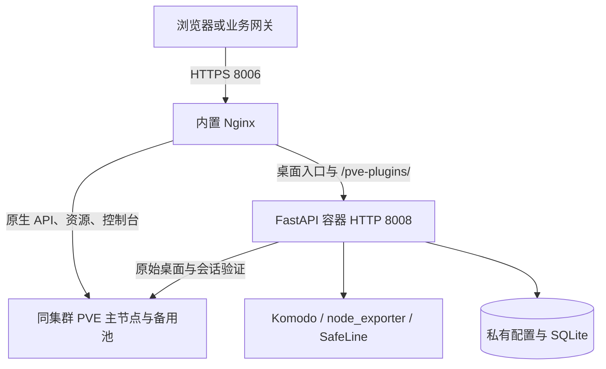

# 架构与设计边界

## 请求路径



内置网关默认启用。它将精确根路径 `/` 与 `/pve-plugins/` 交给应用，其余路径转发 PVE，包括上传下载、原生 API、noVNC 和 xterm.js 控制台 WebSocket。原生控制台也可能使用根路径查询参数，应用识别相应参数后保留原始页面。

`PVE_INTERNAL_PROXY_ENABLED=false` 时不启动 Nginx，应用继续在 HTTP 8008 提供桌面注入与插件 API，默认发布到宿主机 `127.0.0.1:8008`。外部 HAProxy、Nginx 等网关可按路径分流，或保留内置代理并全量转发到 HTTPS 8006。接入步骤见 [[安装与双模式接入|Installation]]。

应用从配置的 PVE 节点取得桌面 HTML，检查 PVE 9 的 `pvemanagerlib.js` 和 `PVE.StdWorkspace` 启动位置，再插入生成片段。插件脚本在官方组件定义之后、原生工作区创建之前执行。

## 多节点与身份

`PVE_UPSTREAM` 使用同集群节点 IP 列表，默认 HTTPS 8006。首项为主节点，也是配置、站点及关联数据使用的稳定 PVE 标识，其余节点组成备用池。切换连接目标不会修改该持久化标识。

Nginx 对 GET/HEAD 的连接、超时和 502/503/504 故障允许转向备用节点，其余方法关闭上游重试。应用的 GET/HEAD 可在收到响应流之前对连接或响应头阶段故障、502/503/504 切换节点，已开始响应体后不重新执行请求。401/403 保留原结果。

普通原生请求连续 10 秒未收到上游数据时触发读取超时，GET/HEAD 可以尝试备用节点。WebSocket 升级路径使用独立的 3600 秒空闲读取超时，已建立的会话保持当前节点连接。

PVE 票据验证中的专用 POST 仅在发送前连接失败时允许换节点。其他应用写入使用单次尝试。备用池不保证严格逐项顺序，节点状态由请求中的被动失败观测更新。已建立的 WebSocket 无法迁移到其他节点，断开后需重新连接。

## TLS 与网关证书

HTTPS 8006 网关使用首次启动生成的持久化自签证书，也支持挂载证书及私钥。默认数据卷的 `proxy/` 保存自动证书对。

容器到 PVE 使用 HTTPS，默认 `PVE_TLS_VERIFY=false`，加密传输但不校验证书与服务身份。严格验证时设置 `PVE_TLS_VERIFY=true`、可信 CA，以及按节点 IP 顺序对齐的 `PVE_TLS_SERVER_NAMES`。网关与 PVE 上游的证书分别配置。

## 插件装配

```text
plugins/*/plugin.json
    → 描述文件校验
    → requires / after 顺序解析
    → 按启用状态导入 plugin:setup
    → 注册插件 API、脚本和关闭处理
    → 生成桌面片段与公开插件清单
```

模块选择和私有连接设置保存在 `plugins.json`。模板组合公开启动信息，生成结果写入 `/run/pve-webui-plugins/`，脚本 URL 带有内容版本参数。Nginx 配置、PID 与临时目录也位于该 runtime tmpfs。

可选插件停用时跳过其实现导入、API 注册、脚本载入和客户端初始化。内置 `sites` 始终加入运行组合，各个站点分别启停。

## 运行时与权限

容器入口监督应用和可选网关，任一必要子进程退出时结束容器。网关关闭模式直接运行应用。单个 Uvicorn worker 和单个实例管理同一数据卷，UID/GID 为 `10001:10001`。

配置保存使用修订检查、文件锁和原子替换。运行组合变化时先建立候选实例，再保存并切换路由。旧实例已接受的 HTTP 请求继续完成，旧插件 WebSocket 关闭后执行清理。

业务 API 核验 PVE 登录、完整双因素状态、管理员白名单及 `/` 上的 `Sys.Audit`。写入校验同源来源及绑定票据的 `X-PVE-Plugins-CSRF`。网关保留含端口的 Host，内置 Nginx 根据 `PVE_TRUSTED_PROXIES` 判断其直接对端的 scheme 标头是否可信。仅应用模式由外部网关归一化协议标头、保留 Host，并限制应用端口的网络访问。

Komodo 与 SafeLine 使用服务端凭据，外部操作受各自服务账号权限限制。配置接口只返回凭据已设置标记。插件与宿主共享进程和权限，接入的 Python package 和前端脚本作为受信任代码管理。

## 非侵入式边界与故障回退

PVE 官方文件、VM/CT 配置和 API 实现保持由 PVE 管理，插件配置、关联数据和证书保存于宿主数据卷。准备 node_exporter、Komodo 或其他外部依赖是独立部署步骤，安装采集器会在相应节点产生软件变更。

内置网关可在桌面读取失败时回退原始 PVE 桌面。单次绕过使用 `/?pve-plugins=off`，`PVE_PLUGINS_INJECTION_ENABLED=false` 关闭注入。原始 PVE `:8006` 仍可独立访问。关闭内置网关后的路径分流与回退规则由外部网关负责。

已加载脚本异常、外部服务故障、站点嵌入限制及 PVE ExtJS 接口变更需要分别验证。兼容性范围见 [[兼容性与发布验证|Compatibility]]。
